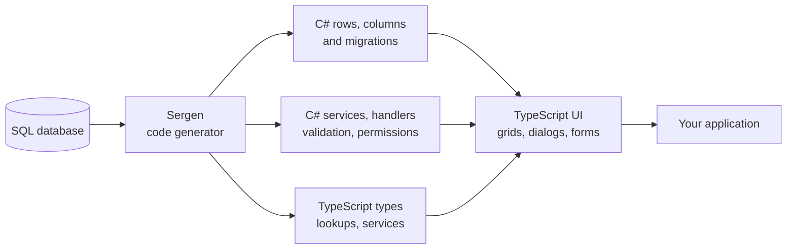

<p align="center">
  
</p>

<h1 align="center">Serenity Application Platform</h1>

<p align="center">
  <strong>Business apps made simple with ASP.NET Core &amp; TypeScript.</strong><br />
  One MIT-licensed stack for grids, forms, services, permissions and code generation — so you can build data-centric applications without rebuilding the plumbing every time.
</p>

<p align="center">
  <a href="https://github.com/serenity-is/Serenity/actions/workflows/test.yml"></a>
  <a href="https://www.nuget.org/packages/Serenity.Net.Core/"></a>
  <a href="https://www.npmjs.com/package/@serenity-is/corelib"></a>
  <a href="https://github.com/serenity-is/Serenity/stargazers"></a>
  <a href="LICENSE.md"></a>
  <a href="https://deepwiki.com/serenity-is/Serenity"></a>
</p>

<p align="center">
  <a href="https://demo.serenity.is"><b>Live demo</b></a> ·
  <a href="#quickstart">Quickstart</a> ·
  <a href="https://serenity.is/docs">Documentation</a> ·
  <a href="https://serenity.is/blog/">Blog</a> ·
  <a href="https://github.com/serenity-is/Serenity/discussions">Discussions</a> ·
  <a href="https://github.com/serenity-is/Serenity/blob/master/CHANGELOG.md">Changelog</a>
</p>

---

## What is Serenity?

Serenity is a **full-stack application platform** for **ASP.NET Core** and **TypeScript**, designed for data-centric business applications: the kind of software built around tables, lists, filters, forms, validation, permissions, exports and audit trails.

Instead of gluing together a UI framework, an ORM, an auth layer and a pile of admin scaffolding — and keeping them in sync forever — Serenity gives you one opinionated stack where the database, the C# model, the services and the TypeScript UI are generated from the same source of truth.

The result: less boilerplate, fewer places to break, and a codebase your team can still reason about years later.

## Why teams choose Serenity

| Capability | What it gives you |
| --- | --- |
| **Start from the database** | Point the **Sergen** code generator at your tables and get rows, columns, services, dialogs, grids, navigation entries, permissions and Excel export — then evolve the generated code by hand. |
| **One model, two languages** | Client-side types, service contracts and lookups are generated from C#. You get real IntelliSense and build-time errors across the C#/TypeScript boundary instead of runtime surprises. |
| **Declarative by default** | Attributes on rows and columns describe display names, sizes, validation, editors, lookups and permissions. The UI reads that metadata — you only write TypeScript when you actually need to customize something. |
| **Secure, not bolted on** | Row- and field-level permissions, service authorization, row-level visibility filters, soft delete and audit logging are part of the platform, not an afterthought. |
| **Your database, your choice** | SQL Server, PostgreSQL, MySQL, Oracle, Firebird and SQLite, with dialect-aware SQL generation and FluentMigrator-based migrations. |
| **No SPA tax** | Server-rendered ASP.NET Core MVC with ES modules and TypeScript on the client. Fast to load, straightforward to host, no separate front-end app to deploy. |

## See it in action

<p align="center">
  <a href="https://demo.serenity.is">
    
  </a>
</p>

<p align="center">
  <sub>Explore the full application at <a href="https://demo.serenity.is">demo.serenity.is</a> — grids, dashboards, reporting, theming and the code generator.</sub>
</p>

## How it fits together



## Batteries included

- **UI** — `EntityGrid`, `EntityDialog`, declarative forms, a rich editor set, inline editing, grouping, Excel-style filters, frozen columns, card views and light/dark themes via [SleekGrid](https://github.com/serenity-is/sleekgrid).
- **Services** — request handlers, validation, unit of work and transactions, caching, distributed cache invalidation, REST-like endpoints derived from entity metadata.
- **Data** — micro-ORM, fluent SQL builders, Dapper integration, LINQ-style query helpers, migrations and per-dialect SQL generation.
- **Security** — attribute-based permissions on rows, fields and services, data visibility filters, audit logging and soft delete / undelete.
- **Platform** — localization with RTL support, script bundling and content versioning, HTML-to-PDF and Excel reporting, declarative navigation and site settings.

## From a table to a CRUD screen

A row definition carries the metadata the whole stack needs — permissions, primary key, quick search, lookup editors:

```csharp
[NorthwindConnection, NorthwindModule, TableName("Customers")]
[ReadPermission(PermissionKeys.Customer.View)]
[ModifyPermission(PermissionKeys.Customer.Modify)]
public sealed class CustomerRow : Row<CustomerRow.RowFields>, IIdRow, INameRow
{
    [DisplayText("Customer Id"), Size(5), PrimaryKey, IdProperty, NotNull, QuickSearch, Updatable(false)]
    public string? CustomerID { get => fields.CustomerID[this]; set => fields.CustomerID[this] = value; }

    [DisplayText("Company Name"), Size(40), NotNull, QuickSearch, NameProperty]
    public string? CompanyName { get => fields.CompanyName[this]; set => fields.CompanyName[this] = value; }

    [DisplayText("Country"), Size(15), AsyncLookupEditor(typeof(Lookups.CustomerCountryLookup))]
    public string? Country { get => fields.Country[this]; set => fields.Country[this] = value; }
}
```

The matching grid is equally short — columns, filters, quick search, editing and export all come from the metadata above:

```ts
import { EntityGrid } from "@serenity-is/corelib";
import { CustomerColumns, CustomerRow, CustomerService } from "../ServerTypes/Demo";

export class CustomerGrid<P = {}> extends EntityGrid<CustomerRow, P> {
    protected override getColumnsKey() { return CustomerColumns.columnsKey; }
    protected override getRowDefinition() { return CustomerRow; }
    protected override getService() { return CustomerService.baseUrl; }
}
```

## Quickstart

**Prerequisites:** [.NET 10 SDK](https://dotnet.microsoft.com/download) · [Node.js 24 LTS](https://nodejs.org/) · Visual Studio 2026 18.8+, or VS Code / the command line.

```bash
# 1. Install the Serene project templates
dotnet new install Serene.Templates

# 2. Create a new application
dotnet new serene -n MySereneApp
cd MySereneApp/MySereneApp.Web

# 3. Install client-side packages and run
npm install
dotnet run
```

Open the URL printed in the console (usually `http://localhost:5000`) and sign in with the seeded **admin** account.

> [!TIP]
> Prefer Visual Studio? Install the [Serene extension](https://marketplace.visualstudio.com/items?itemName=VolkanCeylan.SereneSerenityApplicationTemplate) from the Marketplace and pick **Serene** in the New Project dialog. Don't mix the VSIX and `dotnet new` templates — Visual Studio may pick the older one.

> [!NOTE]
> Building Serenity itself (or contributing) additionally requires [pnpm](https://pnpm.io/installation). Application projects created from the templates use npm.

## Ecosystem

| Project | Description |
| --- | --- |
| [**Serene**](https://github.com/serenity-is/Serene) | The free, MIT-licensed application template — Northwind and Basic Samples included. |
| [**StartSharp**](https://serenity.is/docs/startsharp/README) | Premium template and modules: dashboards, meetings, worklog, email client, data explorer and advanced samples. |
| [**Serenity Developer Tools**](https://github.com/serenity-is/devtools) | Chrome extension to inspect widgets, properties and source code from DevTools. |
| [**SleekGrid**](https://github.com/serenity-is/sleekgrid) | A modern, dependency-free TypeScript data grid — the engine behind Serenity grids. |
| [**DomWise**](https://www.npmjs.com/package/@serenity-is/domwise) | Lightweight JSX with reactive bindings and no virtual DOM, used by the widget system. |

## Repository map

| Path | Contents |
| --- | --- |
| `src/` | The framework — Core, Services, Web, Code Generator and the C#-to-TypeScript transformer. |
| `packages/` | npm packages: `@serenity-is/corelib`, `domwise`, `sleekgrid`, `dtsbundler`, `tsbuild`. |
| `common-features/` | Northwind and Basic Samples modules shared by Serene and StartSharp. |
| `serene/` | The Serene application template and its Visual Studio extension. |
| `tests/` | Unit, integration and code-generator tests. |
| `docs/` | Changelog and release notes. |

## Documentation & learning

- 📖 [**Developer Guide**](https://serenity.is/docs) — concepts, tutorials and step-by-step walkthroughs.
- 🚀 [**Getting started**](https://serenity.is/docs/getting_started/README) — prerequisites and installation options.
- 🧾 [**Changelog**](https://github.com/serenity-is/Serenity/blob/master/CHANGELOG.md) — what changed in every release.
- 🤖 [**DeepWiki**](https://deepwiki.com/serenity-is/Serenity) — ask questions about the codebase.
- 🎥 [**Video tutorials**](https://www.youtube.com/channel/UCHGyxXj-vI32YaRs0v3HvKw) — community-produced, some may be out of date.

<details>
<summary><b>More community videos</b></summary>

- **Starting Point Videos** by @sayuga: https://www.youtube.com/channel/UCHGyxXj-vI32YaRs0v3HvKw
- **Serenity Application Framework** by @samdubey: https://www.youtube.com/c/SerenityApplicationFramework
- **Introduction to Serene** by @samdubey: https://www.youtube.com/watch?v=_AqRl_U_gcw
- **Movie Tutorial**: https://www.youtube.com/playlist?list=PLMr_-cvwVIMWBsgWWUYdbHxBHPrOSzWVf
- **Continuous Deployment on Azure** by @samdubey: https://www.youtube.com/watch?v=tcywhS9k9Wc
- **Videos in Arabic** by @MohamedEbrahimSaad: https://www.youtube.com/watch?v=op15-Q2TDjg

</details>

## Community & contributing

Serenity has been in active development since 2012 and is used in production by teams around the world.

- 💬 **Questions and ideas** → [GitHub Discussions](https://github.com/serenity-is/Serenity/discussions)
- 🐞 **Bugs and feature requests** → [GitHub Issues](https://github.com/serenity-is/Serenity/issues)
- 🤝 **Pull requests** are welcome — docs, samples, bug fixes and tests alike. Please read the [Code of Conduct](.github/CODE_OF_CONDUCT.md) first.
- ⭐ **Starring the repo** helps other developers find the project.

To work on the framework itself:

```bash
dotnet build Serenity.slnx   # build the .NET side
pnpm install && pnpm all     # build, type-check and test the TypeScript packages
```

## License & commercial support

Serenity (including the Serene application template) is **free and open source under the [MIT license](LICENSE.md)**, which permits use in commercial and closed-source applications.

Premium support packages, the **StartSharp** template and additional modules are available at [serenity.is](https://serenity.is). Custom development is also available from the author and a team of Serenity professionals — [get in touch](mailto:sales@serenity.is).
